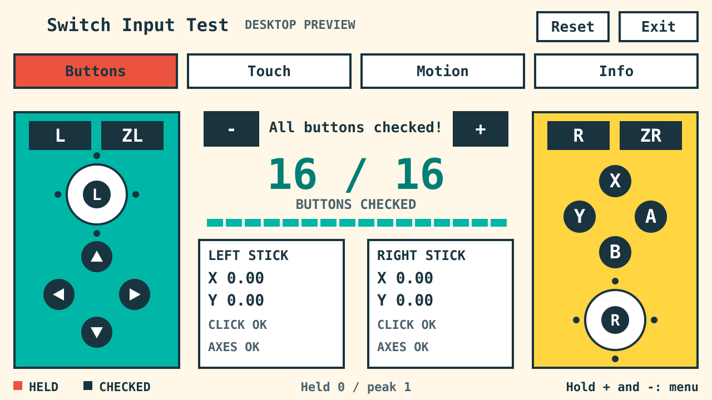

# Switch 2 Homebrew

A growing collection of homebrew games, apps, and hardware tests for Nintendo Switch and Switch 2, built with JavaScript for [CivSwitch](https://github.com/Gezine/CivSwitch), plus supporting tools.

## Apps

### [Switch Input Test](apps/input-test/)

Test gameplay buttons, both sticks, ten-finger touch, raw motion and rumble. A touch-friendly interface with large solid lettering; rumble lives directly on Motion.



[Run and build instructions](apps/input-test/README.md) · [Ready-to-send JavaScript payload](apps/input-test/dist/switch-input-test.js) · [Validation scope](apps/input-test/VALIDATION.md).

## Tools

### [ESP USB-to-Wi-Fi Bridge](tools/esp-bridge/)

Send payloads from your PC over USB to an ESP, then over an offline Wi-Fi network to the console. Your PC stays on its normal network.

```text
PC -- USB --> ESP -- Wi-Fi --> Switch
```

Tested with an ESP8266EX / CP2102, Switch 1 FW 21.2.0 and Switch 2 FW 20.1.5. Both consoles can stay connected; choose which one receives a payload by its IP address. Open and password-protected networks work.

[Build, flash and send instructions](tools/esp-bridge/README.md). ESP firmware is provided as source only.

## License

Each project includes its own license. Input Test is [MIT](apps/input-test/LICENSE), with separate [font/loader notices](apps/input-test/NOTICE.md). The ESP bridge is [GPL-2.0-or-later](tools/esp-bridge/LICENSE); its CivSwitch example has a separate [MIT license](tools/esp-bridge/licenses/CivSwitch-MIT.txt).

## AI Disclaimer

This project was developed with assistance from AI.
