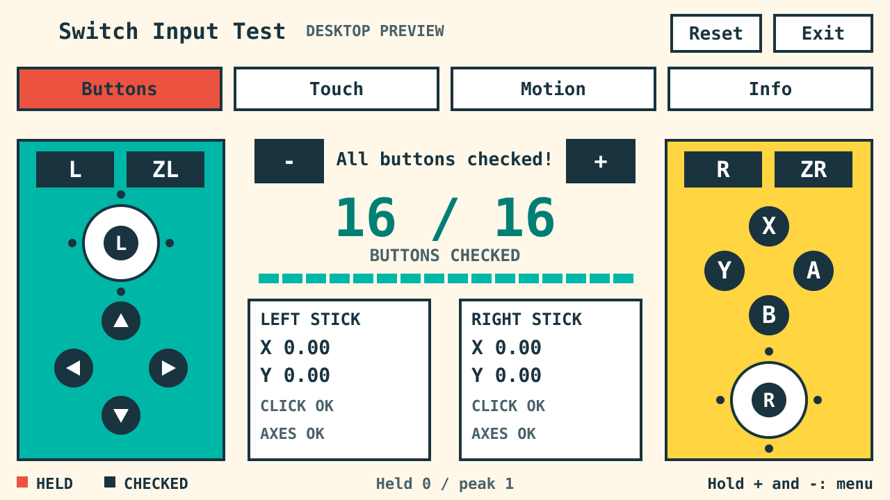
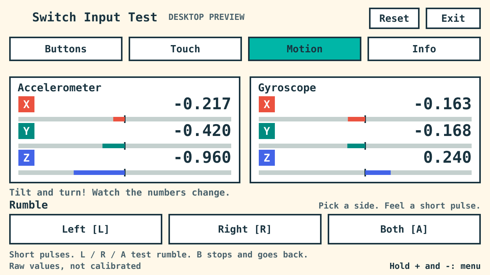

# Switch Input Test

A colorful input tester for the [CivSwitch](https://github.com/Gezine/CivSwitch) JavaScript loader. Test 16 gameplay buttons, both sticks, ten-finger touch, raw motion, and left/right rumble. Large controls, solid letter outlines, and touch-enabled menus.



## Requirements

A working CivSwitch loader is required. This is a JavaScript payload, not an NRO. Native features use compatibility fingerprints and refuse unsupported SDK builds. Buttons, sticks, touch and motion have been tested on Switch 1 and Switch 2; v1.1.0 appearance and rumble have been tested on Switch 2. Switch 1 rumble and the new lettering on Switch 1 remain untested. Hardware/firmware identity is not automatically detected. [Validation scope](VALIDATION.md).

## Run

From the repository root:

```bash
cd apps/input-test
```

Use Python 3.10+. Replace `YOUR_CONSOLE_IP` with the address shown by the loader; no personal address is built into the launcher.

Direct TCP, when the PC can reach the console:

```bash
python3 run.py YOUR_CONSOLE_IP --platform switch2
```

For the repository's [ESP USB bridge](../../tools/esp-bridge/), install the optional serial dependency and supply your serial port explicitly:

```powershell
py -3 -m pip install -r requirements.txt
py -3 run.py YOUR_CONSOLE_IP --platform switch2 --usb --serial YOUR_SERIAL_PORT
```

From Ubuntu/WSL, Windows COM ports are handled through Windows Python automatically; install pyserial in Windows Python first:

```bash
python3 run.py YOUR_CONSOLE_IP --platform switch2 --usb --serial YOUR_SERIAL_PORT
```

Linux serial devices work directly when pyserial is installed in that Python. Close any serial monitor first. The bridge must already have compatible firmware. TCP needs only the Python standard library; USB requires pyserial. There is no default serial port.

Use `--platform switch1` to attribute a Switch 1 capture. The label does not detect hardware. The default duration is ten minutes; `--minutes` accepts 1 to 60. Keep the terminal open. `--fetch` retrieves a completed retained report from the same loader process without restarting the app. Another compatible sender can use [dist/switch-input-test.js](dist/switch-input-test.js) directly. No earlier discovery reports or other workspace projects are needed.

## Controls

- **Buttons:** press/release all 16 gameplay buttons; move both sticks in four directions, return to center, and click them. Coral means held; dark means a press/release was observed. Touching a drawing does not simulate a physical button.
- **Touch:** tap the five targets, drag fingers, lift one independently, and try ten contacts. Display labels start at 1 and remain stable when another finger lifts; raw native IDs are preserved in local reports.
- **Motion:** hold still briefly, then tilt/rotate. Rumble is directly below the readings: tap Left/Right/Both or release physical L/R/A. Each action sends a brief pulse. B, navigation, Reset and Exit stop an active pulse. Rumble never starts merely from opening a page.
- **Info:** three pages of runtime details, navigated by Previous/Next or D-pad left/right.



Reset and Exit require confirmation and wait for the confirming finger/A release. Exit saves the report, cleans up and returns to the loader. Hold **Plus + Minus for one second** for the controller menu; D-pad/left-stick navigates, A selects, B returns. HOME, Capture and C are outside this gameplay input route.

Motion activation and rumble currently require the verified handheld ID32/style2 route. Values are raw, not calibrated orientation. Rumble requires enabled system vibration and mounted devices; the app does not change permission or force a vibration session. Unsupported features are explicit and ordinary input testing stays available. A successful send does not measure perceived vibration.

## Local reports and privacy

Reports save only on the machine running the launcher, under `reports/`. They can contain runtime addresses, host configuration, device metadata and sampled input. Reports, temporary payloads, local configuration, baselines and generated releases are ignored by Git; no captured console report is included here. Do not upload your report without reviewing it.

Reports are bounded: 64 recent input events, first/last 60 motion samples per stream plus ranges, and at most 12 rumble attempt records plus counts/evictions. They are summaries, not complete trajectories. Cleanup records timers/input/overlay/motion/rumble status. Owned sensors are stopped and private buffers freed; vibration receives zero-amplitude stop values. Native faults/process termination can prevent cleanup. SDK initialization can retain normal process-local caches.

Native profiles contain hashes/offsets and instruction checks, not captured SDK bodies. Reference bytes are read from the running process. No game, ROM, save, firmware binary, private capture or personal network configuration is bundled.

## Build and test

Run these commands from `apps/input-test`:

```bash
python3 build.py
python3 -m unittest test_runner.py test_usb.py
npm ci
npm test
npx playwright install chromium
npm run test:browser
python3 package_release.py
```

The build needs only Python. Node 20+ and Playwright are desktop development tools. Browser checks simulate input/native services and create screenshots labeled **DESKTOP PREVIEW**; they do not establish hardware support. The source ZIP is produced from an explicit allowlist. CI runs from the repository workflow at `.github/workflows/input-test.yml`.

All letters are opaque filled outlines, bypassing native text shading, font installation and text textures. Bundled **Solid Mono** ASCII data derives from DejaVu Sans Mono Bold. Ordinary builds need no font tools; optional regeneration uses `tools/generate_solid_mono.py` with fontTools and a separately supplied source font.

## License and credits

Original application and host tools: copyright 2026 fernando-granco, [MIT](LICENSE). [CivSwitch](https://github.com/Gezine/CivSwitch), copyright 2026 Gezine, provides the loader; its [MIT notice](licenses/CivSwitch-MIT.txt) is retained. Solid Mono retains its own [font license](licenses/Solid-Mono.txt). The separate ESP bridge has its own license. Optional pyserial/Playwright dependencies retain their distribution licenses. [Notices](NOTICE.md). Developed with AI assistance.
