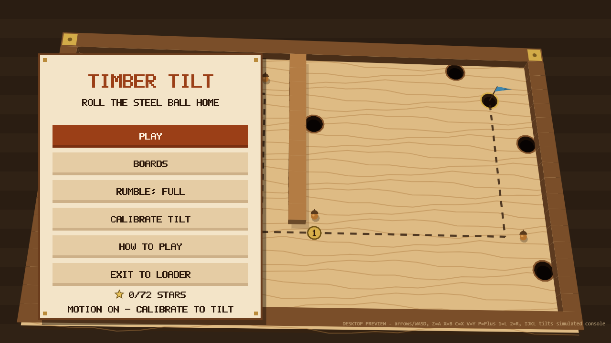

# Timber Tilt

An original tilt-maze game for the [CivSwitch](https://github.com/Gezine/CivSwitch) JavaScript loader. Tilt a wooden board drawn in perspective to roll a steel ball along a dotted guide line. Avoid the holes, pass the brass checkpoint tacks and drop the ball into the cup under the blue flag. Play by tilting the console, with the stick, or by dragging on the touch screen. Rumble taps the side of the console that hit a wall.



It belongs to the classic ball-labyrinth genre (the physical wooden toy). The name, the 24 boards, the mechanics (felt, varnish, brass pegs, acorns, stars), the Canvas art and the block lettering are all original.

## Requirements

You need a working CivSwitch loader. This is a JavaScript payload, not an NRO. Native features use compatibility fingerprints and refuse unsupported SDK builds; the game stays playable with the stick and touch if they are refused.

Tested on Switch 2 in handheld mode: motion tilt, touch, buttons and rumble. Switch 1 has not been tested with this game, and rumble works only in the handheld layout. Hardware and firmware identity are not detected.

## Run

From the repository root:

```bash
cd apps/timber-tilt
```

Use Python 3.10+. Replace `YOUR_CONSOLE_IP` with the address shown by the loader. No address is built into the launcher.

Direct TCP, when the PC can reach the console:

```bash
python3 run.py YOUR_CONSOLE_IP --platform switch2
```

For the repository's [ESP USB bridge](../../tools/esp-bridge/), install the optional serial dependency and give your serial port explicitly:

```bash
python3 -m pip install -r requirements.txt
python3 run.py YOUR_CONSOLE_IP --platform switch2 --usb --serial YOUR_SERIAL_PORT
```

From Ubuntu/WSL, Windows COM ports go through Windows Python automatically; install pyserial in Windows Python first.

Keep the terminal open. It prints `TIMBER_TILT alive …` heartbeats and saves an integrity-checked report under `reports/` when you choose **EXIT TO LOADER**. The default session limit is 30 minutes; `--minutes` takes 1 to 60. `--fetch` retrieves a completed report from the same loader process. Any compatible sender can also use [dist/timber-tilt.js](dist/timber-tilt.js) directly.

Exiting stops any rumble (zero-amplitude send and free), stops the motion sensor the game started, detaches input, removes the canvas and hands control back to the loader.

## Playing

1. Wait about 2 seconds on the title screen for motion to start.
2. **PLAY** goes to the first board you haven't cleared this session. The first time, a short tilt calibration runs: hold still, tilt the right side down, level, tilt the top edge away, level. The game learns the tilt directions from your own movements. **SKIP (X)** plays with the stick and touch only.
3. Roll to the cup. Falling in a hole puts you back at the last checkpoint you reached.

| Control | Action |
| --- | --- |
| Tilt the console | Tilt the board (after calibration) |
| Left stick / D-pad | Tilt the board (always available, added to motion) |
| Drag on the board | Touch joystick: drag from where your finger lands |
| Y or touch RECENTER | Make the current hold the level position |
| R (hold) | Precision: half tilt |
| L | Restart the board |
| Plus / Minus / B or touch PAUSE | Pause: resume, recenter, sensitivity, rumble, restart, calibrate, boards, exit |
| X | Info panel: tilt, accelerometer, motion, rumble and frame time |
| Board picker | D-pad/stick across tiles; L/R or the tabs switch chapters; A or touch plays |

**Boards:** 24 boards in four chapters, each in its own wood: Pine, Oak, Cherry and Walnut.
- **Pieces:** green felt slows the ball, shiny varnish is slippery, brass pegs bounce it, and each board has three acorns to collect.
- **Stars:** one for reaching the cup, one for all three acorns and one for beating the par time.
- **Session only:** best times, stars and acorns are not saved.

**Rumble:**
- **Patterns:** wall taps buzz the side that hit. Pegs, acorns, checkpoints, falls, reaching the cup and finishing calibration each have their own short pattern.
- **Modes:** choose FULL, LIGHT (big moments only) or OFF in the title or pause menu.
- **Tilt hold:** while a pattern plays, the game holds the last tilt reading, because vibration shakes the accelerometer.

## How it works

- [physics.js](physics.js): 240 Hz fixed-step ball with walls, pegs, surfaces, pits with a lip pull, checkpoints and acorns.
- [tilt.js](tilt.js): the calibration wizard. It maps raw accelerometer directions to board tilt without assuming axes or signs.
- [render.js](render.js) and [font.js](font.js): the perspective board and a 5×7 block font. Only paths, `arc` and `fillRect` are used: no images, gradients, pixel access, SVG or system fonts.
- [haptics.js](haptics.js): rumble patterns on top of the repository's handheld pulse helper.
  - **One bounded transaction per setup:** a fresh code check, the permission check, start/stop steps within the helper's call budget, then a zero-amplitude send and a free.
  - **Outside the frame:** setup runs after the frame is drawn.
  - **Reuse:** a zeroed transaction is kept for up to 1.5 s so back-to-back buzzes skip setup.
  - **Fixed strength:** the accepted 0.45 at 160/320 Hz; only duration and side vary.
- [levels.js](levels.js): generated by [tools/make_levels.cjs](tools/make_levels.cjs). Every board is checked by an [autopilot](tools/autopilot.cjs) that must clear it without a fall; par times come from its time.
- [vendor/](vendor/): byte-identical copies of the input, touch, motion, rumble and report-transport libraries shipped with this repository's [Switch Input Test](../input-test/), pinned in [vendor/manifest.json](vendor/manifest.json). `build.py` refuses mismatches.

## Report

`timber-tilt/1` JSON saved locally. It contains:
- session reason, errors and warnings
- per-board attempts, clears, best time, falls, stars and acorns
- totals and controls used
- the calibration result
- the motion and rumble lifecycle (setup timing, reuse, zero/free results)
- frame timing per view, the canvas colour fallback flag and cleanup flags

Reports stay in `reports/`, which git ignores.

## Checks (offline)

```text
python3 build.py                                  # writes dist/timber-tilt.js and dist/manifest.json
python3 -m unittest test_runner.py test_usb.py    # framing, schema, payload contents/bans, vendor guard, USB protocol
npm ci && npm test                                # boards/physics, tilt wizard, rumble wrapper, lettering
npm run test:browser                              # headless Chromium: full flow with simulated input, motion and rumble
node tools/make_levels.cjs                        # regenerate levels.js (autopilot-verified)
```

To try it on a desktop, open `preview.html` (arrows/WASD, Z=A, X=B, C=X, V=Y, P=Plus, 1=L, 2=R, I/J/K/L tilt a simulated console; `?first=N` moves board N to the front). Desktop runs are simulations, not hardware evidence.

## License

MIT; see [LICENSE](LICENSE) and [NOTICE.md](NOTICE.md).
